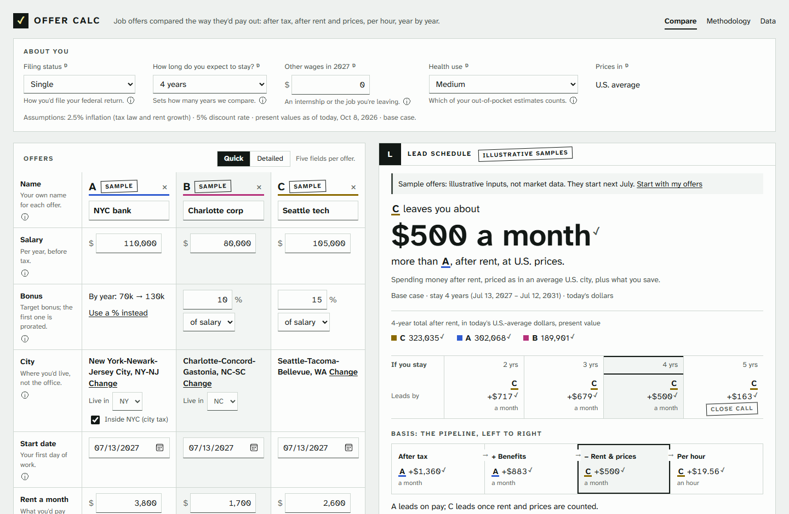

# Offer Calc

Work out a job offer the way it would actually pay out: after federal, state, local and payroll tax,
after rent and local prices, and per hour worked, year by year. Every offer gets its own breakdown,
from its bottom line to every payment; two or three are compared side by side. Every figure shows its work.

**Live:** https://offer-calc.vercel.app



*The sample offers are illustrative inputs, not market data.*

## What it does

One pipeline, left to right, for two or three offers:

1. **Gross pay:** salary, bonuses (as a percent, dollars, or by year), sign-ons and other cash, and
   RSUs as they vest on the company's dates.
2. **After tax:** federal income tax, Social Security and Medicare, state and local tax, each
   calendar year, as the offer's share of your household's tax; less your health premiums.
3. **+ Benefits (total rewards):** plus the employer 401(k) money you'd keep (vesting applied), perks
   and employer HSA money, less expected out-of-pocket health costs.
4. **− Rent & prices (after rent, at U.S. prices):** spending money after rent, priced as in an
   average U.S. city (BEA Regional Price Parities), plus what you save at face value. This is the
   default verdict.
5. **Per hour:** step 4, after rent, divided by the hours you'd work, and what each extra hour pays.

The verdict is a present value restated as a level amount a month over the years you expect to stay,
with the winner for stays of 2 to 5 years beside it. Every figure carries an audit tickmark: click it to
see its derivation with your values, the figures it uses, and its section of the
[methodology](https://offer-calc.vercel.app/#/method). Quick mode asks for five fields per offer;
detailed mode covers raises, promotions, bonus timing, RSU vesting, refreshers, the 401(k), health,
perks, cash awards with clawbacks, and hours.

It runs entirely in your browser: no account, no server, no analytics. What you enter is saved in
this browser only, and the Data page exports it to a JSON file and imports it back.

## Setup

Needs Node.js 24.

```bash
npm ci
npm test            # unit tests (engine and app), then the no-formatting-in-the-engine check
npm run typecheck
npm run dev         # the app at http://localhost:5173
npm run build       # static build in dist/ (deployed on Vercel; see vercel.json)
npm run e2e         # after the build: the accessibility scan (axe), smoke and keyboard tests, in Playwright
npm run offers      # the sample offers' tables, in the terminal
```

The code: `src/tax` (the tax engine), `src/offer` (offers to dated, taxed payments; comparisons),
`src/col` (BEA price levels and HUD rents), `src/format` (words for the engine's numbers), and `app/`
(React 19 on Vite; the engine runs in a Web Worker). The design documents are
[`docs/offer-model.md`](docs/offer-model.md) and [`docs/ui-design.md`](docs/ui-design.md).

## Validation

- **Unit tests** check hand-worked values at the edges: the day before and the day of a vest, a payout
  or a window's end; tax thresholds and bracket crossings. The app's tests fail if any figure lacks a
  tickmark, a methodology section or a derivation, if any input lacks its help, or if a default shown
  in the app disagrees with the engine's.
- **The tax engine is checked against [PolicyEngine-US](https://github.com/PolicyEngine/policyengine-us)**
  (version 2.30.3) for 2026 law, on wages from $40,000 to $320,000 for every state and DC, single and
  married filing jointly. Social Security, Medicare and state payroll taxes match exactly; New York
  City within $0.48. For single filers from $60,000 to $200,000, federal income tax is within $5 in 50
  of 51 places and state income tax in 42 of 51 (44 within $6). The differences that remain, and the
  ones that are intentional, are listed in the methodology (M-4, M-10).

To run the comparison yourself (a few minutes; it writes `oracle_report.json`), install PolicyEngine
into a virtual environment named `.venv`, which `npm run oracle` uses automatically. `requirements-lock.txt`
holds every package at the version the comparison's baseline was taken with (Python 3.14 on Windows), so
install with it as constraints; `npm run oracle` warns if your environment differs from it.

macOS / Linux:
```bash
python3 -m venv .venv
.venv/bin/python -m pip install -r requirements.txt -c requirements-lock.txt
npm run oracle
```

Windows (PowerShell):
```powershell
py -m venv .venv
.venv\Scripts\python -m pip install -r requirements.txt -c requirements-lock.txt
npm run oracle
```

## Data and attribution

- **BEA Regional Price Parities**, 2024, released February 19, 2026 (U.S. Bureau of Economic
  Analysis): price levels for every metro area and state. Re-download with `npm run fetch-rpp`.
- **HUD Fair Market Rents**, FY 2027 (U.S. Department of Housing and Urban Development): the rent
  estimates. Re-download with `npm run fetch-fmr`; HUD USER may ask for the file to be downloaded in a
  browser, and the script says how.
- **Census Bureau, American Community Survey 2024 1-year, table B25064:** the U.S. median gross rent,
  used only where HUD has no figure.
- **IRS** Rev. Proc. 2025-32, Notice 2025-67, Rev. Proc. 2025-19, Rev. Proc. 2026-24 (2027's HSA
  limits), and Publications 15 and 15-T; the **Social Security Administration**'s 2026 and 2027 fact
  sheets (the wage base).
- **Tax Foundation**, "State Individual Income Tax Rates and Brackets, 2026", and each state law enacted
  after it, listed in the methodology (M-11).
- **PolicyEngine-US**, used only to validate the tax engine; it isn't part of the app.
- **Atkinson Hyperlegible Next and Mono** (Braille Institute, SIL Open Font License 1.1) and **React**
  (MIT License), installed from npm.

The sample offers are illustrative inputs, not market data. Nothing here is tax or financial advice.

## How it was built

Built with [Claude Code](https://claude.com/claude-code), Anthropic's AI coding assistant, with the
design, decisions and review by the author. Every commit carries a "Co-Authored-By: Claude" trailer.

## License

© 2026 Owen Chapman. All rights reserved. Source shown for review only.
